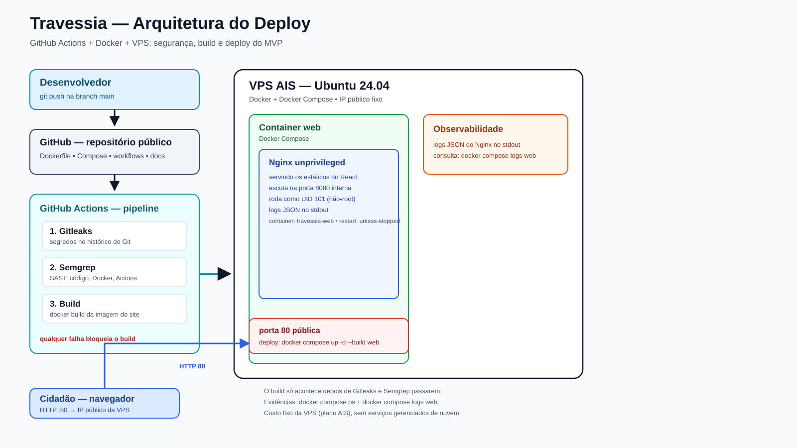

# Travessia — Assistente de semáforo para pedestres

> MVP da **Global Solution FIAP 2026.2 — CitizenTech**, empacotado em container e
> publicado em uma **VPS própria** (AIS, Ubuntu 24.04) com Docker e Nginx.

**URL pública:** <http://4.168.236.152/>
**Repositório público:** <https://github.com/guicvsub/gs-dev-sec>
**Pipeline:** [`.github/workflows/deploy.yml`](.github/workflows/deploy.yml)
**Relatório:** [`docs/RELATORIO.md`](docs/RELATORIO.md) • **Evidências:** [`docs/EVIDENCIAS.md`](docs/EVIDENCIAS.md) • **Guia de deploy:** [`DEPLOY.md`](DEPLOY.md)



---

## Ficha Técnica do MVP

| Campo | Descrição |
| --- | --- |
| **Nome** | Travessia — assistente de semáforo para pedestres |
| **Projeto** | CitizenTech — FIAP Global Solution 2026.2 |
| **Atividade** | Deploy seguro em VPS (Secure DevOps Tools & Cloud Computing) |
| **Equipe** | GS7 (Global Solution 7) |
| **Integrantes** | Guilherme Santiago da Silva (RM552321), Gustavo Govea Soares (RM553842), Pedro Henrique Mello Silva Alves (RM554223), Gabriel Borba (RM553187) |
| **Problema** | Pessoas cegas ou com baixa visão não conseguem interpretar com segurança a faixa de pedestre e o semáforo ao atravessar a rua. |
| **Solução** | Uma câmera vestível (ESP32-CAM) filma a via; o software reconhece faixa, semáforo e veículos e devolve um aviso simples em tela, voz e vibração. |
| **MVP demonstrável** | Site em React que reproduz um vídeo público de São Paulo com as detecções do modelo sobrepostas e o aviso acessível. Usa detecções já salvas, então **não precisa de chave do Roboflow para rodar**. |
| **Público-alvo** | Pessoas com deficiência visual, seus acompanhantes e equipes de mobilidade urbana. |
| **Stack** | React 19 + Vite 8 + Tailwind 4; Python 3.13 + OpenCV + Roboflow (núcleo opcional); Docker; Nginx unprivileged; GitHub Actions. |
| **Infraestrutura** | VPS Linux (AIS) com Docker Compose; Nginx (PaaS do container) servindo o site na porta 80. |
| **Segurança** | Gitleaks e Semgrep bloqueando o deploy; secrets fora do repositório; container roda sem root (UID 101); headers de segurança no Nginx. |
| **Observabilidade** | Logs JSON do Nginx no stdout do container (fáceis de consultar com `docker compose logs`). |
| **Status** | **No ar** em <http://4.168.236.152/> (VPS AIS, Ubuntu 24.04, Docker + Nginx) |

---

## O que é o MVP

No produto final, uma câmera vestível ESP32-CAM filma a rua à frente de uma pessoa cega ou
com baixa visão. O software reconhece faixa de pedestre e semáforo e transforma o que viu
em um aviso simples.

Para esta demonstração, **a imagem da ESP32-CAM foi substituída por um vídeo público do
YouTube** gravado em uma rua de São Paulo. O vídeo passa pelo mesmo caminho que a câmera
faria: cada quadro é enviado ao modelo de visão computacional, e o resultado vira uma das
mensagens abaixo. Trocar o vídeo pela câmera exige mudar só a fonte da imagem; a análise e
as regras continuam as mesmas.

O projeto tem duas partes:

- **`main.py` + `utility/`**: núcleo em Python, que analisa o vídeo com o modelo do Roboflow.
- **`frontend/`**: página em React + Tailwind que apresenta o MVP. Ela toca o mesmo vídeo
  com as detecções do modelo por cima e mostra o aviso em tela, por voz e por vibração.
  A página não tem back-end: usa as detecções já geradas em
  `frontend/public/dados/deteccoes-video.json`.

> O site é o **MVP público** e é o que sobe na VPS. O núcleo em Python é opcional, roda em
> modo headless e consome créditos do Roboflow; ele não é iniciado pelo pipeline.

### Funcionalidades

- Reproduz um vídeo do YouTube em uma janela.
- Sobrepõe as detecções do modelo (classes `pedestrian_crossing`, `green_light`,
  `red_light` e `vehicle`) ao vídeo.
- A cada análise, gera uma das mensagens:
  - "Faixa de pedestre e semáforo verde a frente"
  - "Faixa de pedestre e semáforo vermelho a frente"
  - "Faixa de pedestre sem semáforo a frente"
  - "Semáforo verde a frente (sem faixa de pedestre)"
  - "Semáforo vermelho a frente (sem faixa de pedestre)"
  - "----------Nada relevante pode ser detectado----------"
  > Se houver semáforo verde e vermelho no mesmo frame, vale o de maior confiança.
- Mostra o aviso em tela, fala o aviso e aciona a vibração no celular.
- No núcleo Python, os frames com detecção aparecem em uma segunda janela; **Q** ou
  **ESC** encerram.

---

## Arquitetura

O diagrama completo está em [`docs/arquitetura.svg`](docs/arquitetura.svg) e é reproduzido
no [relatório](docs/RELATORIO.md). O fluxo é:

```text
git push na main
        │
        ▼
GitHub Actions — security (Gitleaks + Semgrep)
        │
        ▼
GitHub Actions — build da imagem Docker
        │
        ▼
VPS AIS (Ubuntu 24.04) — Docker Compose + Nginx não-root :8080 → porta 80
        │
        └─ docker compose pull && docker compose up -d (deploy)
```

| Camada | Componente | Papel |
| --- | --- | --- |
| Aplicação | Container `web` (Docker) | Servir o site em React via Nginx. |
| Servidor | VPS AIS (Ubuntu 24.04) | Hospedagem do Docker até o MVP; IP público fixo. |
| Proxy/Web | Nginx unprivileged | Expoe a porta 80 e serve os arquivos estáticos. |
| CI/CD | GitHub Actions | Gitleaks + Semgrep (segurança) e build da imagem. |
| Observabilidade | Logs JSON no stdout | Consulta com `docker compose logs web`. |

### Por que o site não precisa do Roboflow em produção?

As detecções usadas na apresentação já estão no arquivo
`frontend/public/dados/deteccoes-video.json`. O build do Vite copia esse arquivo para a
imagem; o Nginx o serve como conteúdo estático. Assim, o deploy público não expõe chave
de API, não gasta créditos e não depende do YouTube para carregar as detecções.

---

## Pipeline DevSecOps

O workflow principal é o [`deploy.yml`](.github/workflows/deploy.yml). Ele roda em todo
push na `main` e também pode ser disparado manualmente em **Actions → Deploy → Run
workflow**.

| Ordem | Job | Ferramenta | O que valida | Se falhar |
| --- | --- | --- | --- | --- |
| 1 | `security` → `gitleaks` | Gitleaks 8.28 | Segredos no histórico completo do Git (fetch-depth 0). | O deploy não começa. |
| 2 | `security` → `semgrep` | Semgrep (`p/default` + `p/secrets`) | SAST de Python, JavaScript, Dockerfile e workflows. | O deploy não começa. |
| 3 | `build` | Docker | Build da imagem `travessia-web:latest`. | O site antigo continua no ar na VPS. |

O workflow de PR (`.github/workflows/pr.yml`) repete a segurança e faz o build da imagem
sem publicar nada.

**Decisões de segurança do pipeline:**

- As actions são referenciadas pelo **SHA completo** do commit, não por tags móveis.
- O Gitleaks roda com `--redact` e falha com `--exit-code 1`; o relatório do Semgrep é
  publicado como artefato SARIF.
- O container roda como usuário **nginx (UID 101)**, não como root.
- O `.env` real (com a chave do Roboflow) nunca entra no repositório.

---

## Observabilidade

- **Logs:** o Nginx grava access logs em **JSON no stdout**. Consulte com
  `docker compose logs web`.
- **Formato JSON:** permite filtrar por `status`, `request`, `remote_addr`, `bytes` e
  `user_agent` de forma simples.

---

## Como rodar localmente

### Site com Docker (recomendado)

```bash
docker compose up -d --build web
```

Abra `http://localhost` (ou a porta definida em `WEB_PORT`). O compose usa a imagem
`nginxinc/nginx-unprivileged` e mapeia `80:8080`; se a porta 80 estiver ocupada:

```powershell
$env:WEB_PORT="8085"; docker compose up -d --build web
```

Verificação rápida:

```bash
docker compose ps
curl -I http://localhost
docker compose logs web
```

> Use sempre `--build` depois de mudar o Dockerfile ou o `nginx.conf`; sem isso o Compose
> reutiliza a imagem antiga em cache.

### Front-end em modo de desenvolvimento

```powershell
cd frontend
npm install
npm run dev
```

Abra `http://localhost:5173` e aperte **Iniciar**. O site não precisa do Python nem da
chave do Roboflow.

### Núcleo em Python (opcional)

1. Crie e ative o ambiente virtual:
   ```powershell
   python -m venv venv
   .\venv\Scripts\Activate.ps1
   ```
2. Instale as dependências:
   ```powershell
   python -m pip install -r .\requirements.txt
   ```
3. Crie o `.env` a partir do exemplo e preencha a chave:
   ```powershell
   Copy-Item .env.example .env
   ```
   ```env
   ROBOFLOW_API_KEY=sua_chave_do_roboflow_aqui
   VIDEO_URL=https://youtu.be/seu_video_de_preferencia
   ```
   > O `.env` é ignorado pelo Git. **Nunca** faça commit dele.
4. Execute:
   ```powershell
   python main.py
   ```
   Para rodar sem interface gráfica (headless), defina `HEADLESS=1`; é o modo usado no
   container `core`.

### Núcleo em Python com Docker (opcional)

```bash
docker compose --profile core up -d --build
docker compose logs -f core
```

O perfil `core` consome créditos do Roboflow (≈ 2 chamadas/s) e não é iniciado pelo
pipeline de produção.

---

## Deploy em produção (VPS AIS)

O passo a passo completo, incluindo a configuração da VPS, está em
[`DEPLOY.md`](DEPLOY.md). Resumo:

1. **Crie um repositório público** no GitHub e envie este projeto para a branch `main`.
2. **Na VPS**, instale Docker e Docker Compose (Ubuntu 24.04).
3. Copie o projeto (ou faça `git clone`) para a VPS.
4. Crie o `.env` na VPS (apenas se for usar o núcleo Python opcional).
5. Suba o site:
   ```bash
   docker compose up -d --build web
   ```
6. Confirme que a URL pública responde:
   ```bash
   curl -I http://IP_DA_VPS
   ```

> O IP público da VPS é fixo; o MVP fica disponível em <http://4.168.236.152/>.

---

## Estrutura do repositório

```text
.
├── .github/workflows/
│   ├── security.yml        # Gitleaks + Semgrep (reutilizável)
│   ├── pr.yml              # segurança + build da imagem
│   └── deploy.yml          # pipeline principal (push na main)
├── scripts/
│   └── deploy-vps.sh       # deploy manual na VPS (Docker Compose)
├── Dockerfile              # build do site + Nginx unprivileged :8080
├── Dockerfile.core         # núcleo Python headless (opcional)
├── docker-compose.yml
├── nginx.conf              # logs JSON, headers de segurança, SPA fallback
├── frontend/               # site React + Vite
├── main.py + utility/      # núcleo Python (opcional)
├── docs/
│   ├── arquitetura.svg
│   ├── RELATORIO.md
│   ├── EVIDENCIAS.md
│   ├── relatorio.html      # versão para exportar em PDF
│   └── prints/             # prints das evidências
├── DEPLOY.md
└── README.md
```

---

## Segurança e limitações

- **Segredos:** o `.env` real fica fora do Git; o `.env.example` tem apenas placeholder.
  Se uma chave vazar no histórico, o Gitleaks bloqueia o pipeline. Nesse caso, **rotacione
  a chave** e reescreva o histórico (ou recrie o repositório).
- **CI/CD:** o pipeline valida segurança e build. O deploy na VPS é manual (via Docker
  Compose). Uma evolução é integrar o deploy à pipeline com SSH.
- **HTTP:** o MVP é publicado em HTTP (sem domínio/HTTPS). Uma evolução é usar um proxy
  TLS (Caddy com Let's Encrypt, por exemplo).
- **Backup:** a VPS não possui snapshot automático configurado; recomenda-se criar
  snapshots periódicos.

---

## Equipe

| Nome | RM | Responsabilidade |
| --- | --- | --- |
| Guilherme Santiago da Silva | RM552321 | Full-stack / infraestrutura |
| Gustavo Govea Soares | RM553842 | Front-end / interface |
| Pedro Henrique Mello Silva Alves | RM554223 | Núcleo Python / visão computacional |
| Gabriel Borba | RM553187 | Pipeline / DevSecOps |

---

## Referências

- [Guia de deploy na VPS](DEPLOY.md)
- [Relatório do Deploy](docs/RELATORIO.md)
- [Checklist de evidências](docs/EVIDENCIAS.md)
- [Documentação do front-end](frontend/README.md)
- [GitHub Actions — reusing workflows](https://docs.github.com/actions/using-workflows/reusing-workflows)