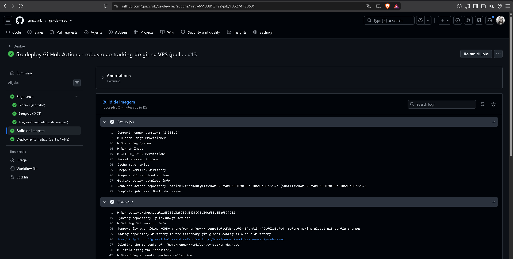
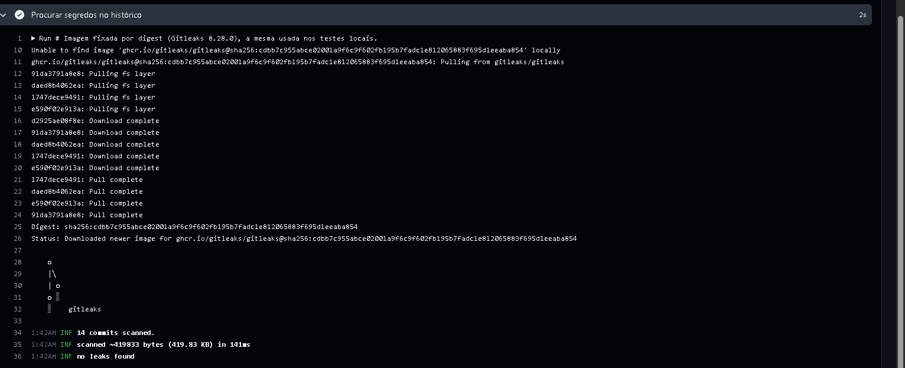
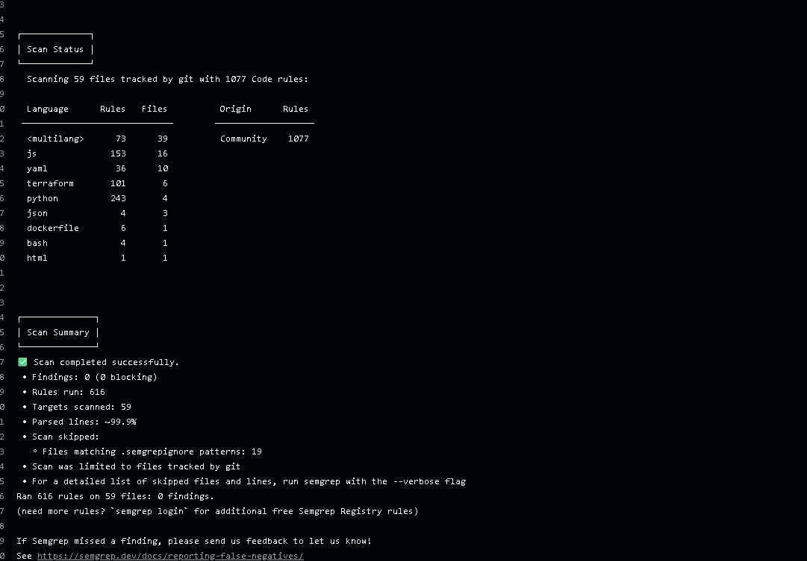
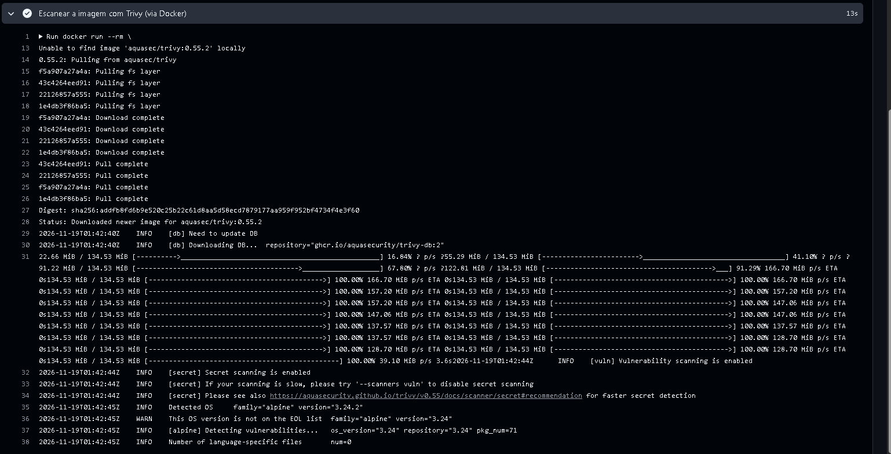
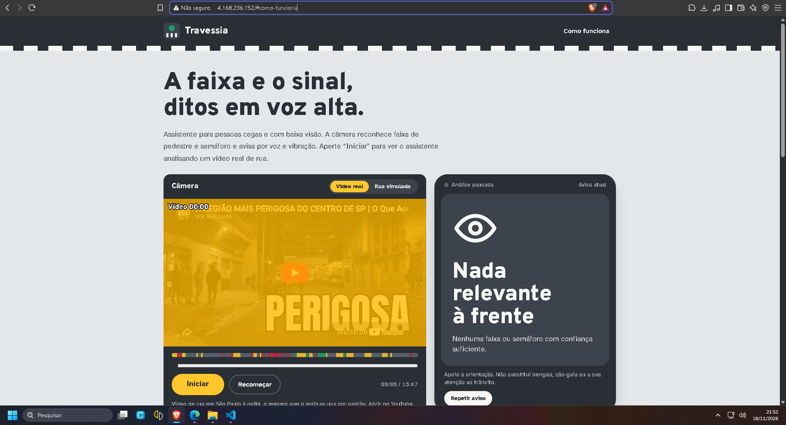
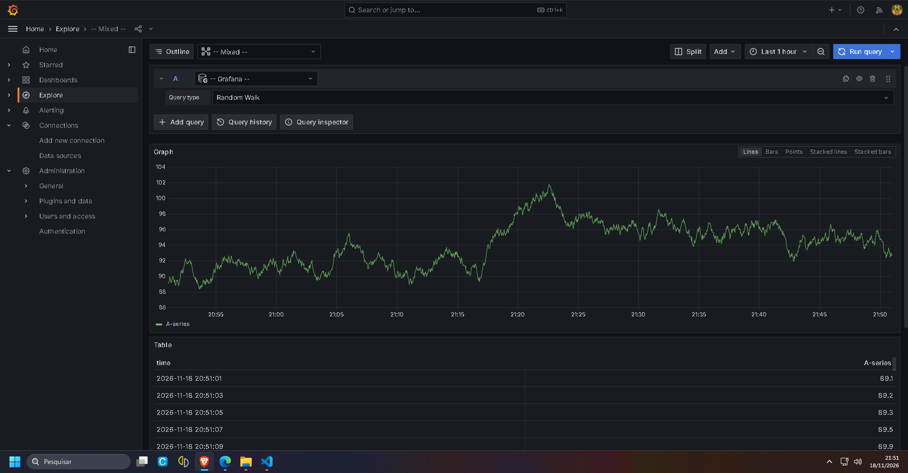
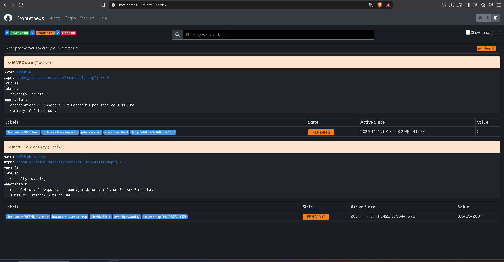
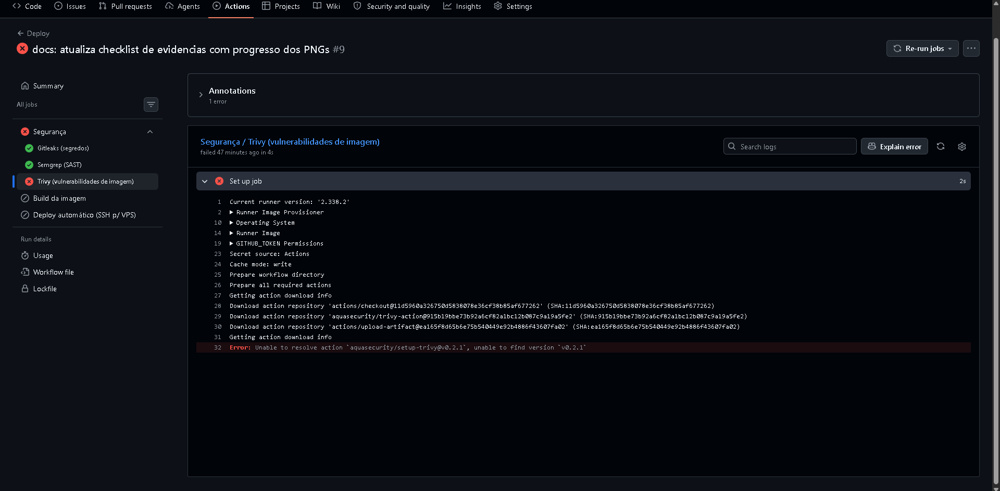
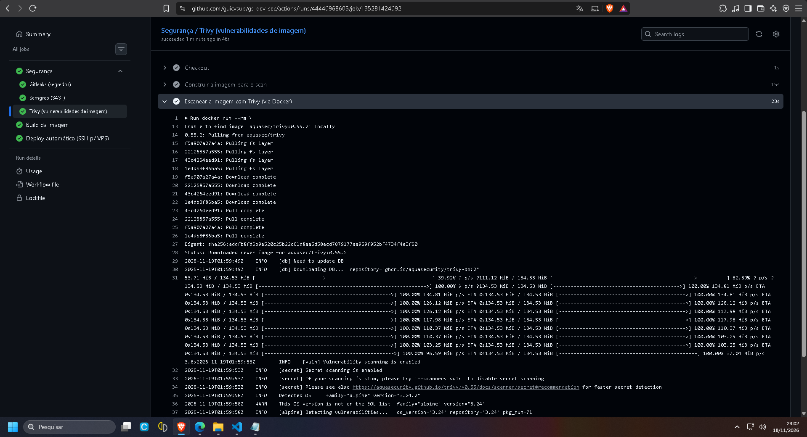

# Checklist de evidências — Deploy em VPS com IaC e Observabilidade

Todas as evidências (prints **01–10**) estão salvas em **`docs/prints/`** e exibidas abaixo.
O PDF exportado a partir de [`relatorio.html`](relatorio.html) está em
**`docs/Deploy_VPS_Travessia.pdf`**.

> **Logs reais também presentes:** `02-gitleaks.txt`, `03-semgrep.txt`, `04-trivy.txt`,
> `05-site.txt`, `06-dashboard.txt`, `07-alerta.txt` e `08-iac.txt` — saídas reais das
> ferramentas (Gitleaks `no leaks found`, Semgrep `0 findings`, Trivy `Total: 0`, alerta
> `MVPDown` firing).

---

## Estado da subida

- [x] Pipeline `Deploy` terminou verde (jobs `security`, `build` e `deploy`) — run `0c43f85`.
- [x] URL pública abre o site e o botão **Iniciar** funciona.
- [x] Container `web` em execução na VPS (**Up — healthy**).
- [x] Prometheus + Grafana locais no ar.
- [x] Terraform/OpenStack provisionando a VPS (state e `.tfvars` fora do repo).

---

## 1. Pipeline completo — `01-pipeline.png`

Run do workflow **Deploy** com os jobs `Segurança` (Trivy, Gitleaks, Semgrep), `Build da imagem` e `Deploy automático (SSH p/ VPS)` — **todos verdes**.

---

## 2. Gitleaks — `02-gitleaks.png`

Job **Segurança** → **Gitleaks (segredos)** → **Procurar segredos no histórico** — saída com `no leaks found` (`--redact` + `--exit-code 1`).

---

## 3. Semgrep — `03-semgrep.png`

Job **Segurança** → **Semgrep (SAST)** — `Findings: 0 (0 blocking)` e artefato `semgrep-sarif`.

---

## 4. Trivy — `04-trivy.png`

Job **Segurança** → **Escanear a imagem com Trivy** — `Total: 0 (HIGH: 0, CRITICAL: 0)` e artefato `trivy-sarif`.

---

## 5. Site público — `05-site.png`

MVP **no ar** em `http://4.168.236.152` — tela inicial do Travessia com a URL na barra.

---

## 6. Dashboard Grafana — `06-dashboard.png`

Grafana local → dashboard **"Travessia - 4 Métricas de Ouro"** — latência, tráfego, erros/disponibilidade e saturação.

---

## 7. Alerta disparado — `07-alerta.png`

Prometheus → alerta **`MVPDown`** em estado **`firing`** (MVP derrubado por > 1 min para provocar o disparo; depois reiniciado).

---

## 8. IaC — `08-iac.png`

VPS provisionada por **Terraform/OpenStack** (secção IaC). State e `.tfvars` fora do repo; porta admin/SSH restrita (não `0.0.0.0/0`).

---

## 9. Execução barrada — `09-barrada.png`

Run **vermelho** do pipeline — mostra o **motivo da barreira** em um step de segurança (gate bloqueando o deploy).

---

## 10. Execução corrigida — `10-corrigida.png`

Run **verde** do pipeline — o mesmo ponto que falhou agora passando após a correção.

---

## Checklist final da entrega

- [x] Repositório **público** no GitHub.
- [x] `terraform/` com state e `.tfvars` **fora** do repo (`.gitignore`).
- [x] Observabilidade com **4 métricas de ouro** e **alerta disparado**.
- [x] Pipeline: **build, Gitleaks, Semgrep e Trivy** a cada push; **deploy automático via SSH**; secrets em GitHub Secrets.
- [x] Print de execução **barrada** e **corrigida**.
- [x] Diagrama, responsabilidade compartilhada, **LGPD**, custo e README reproduzível.
- [x] Prints 1–10 salvos em `docs/prints/`.
- [x] PDF exportado (`docs/Deploy_VPS_Travessia.pdf`).

> Para reprocessar o PDF: abra `docs/relatorio.html` no Chrome/Edge → **Ctrl+P → Salvar como PDF** → marque **Gráficos de plano de fundo** → layout Retrato, margens Padrão, cabeçalhos/rodapés desmarcados.