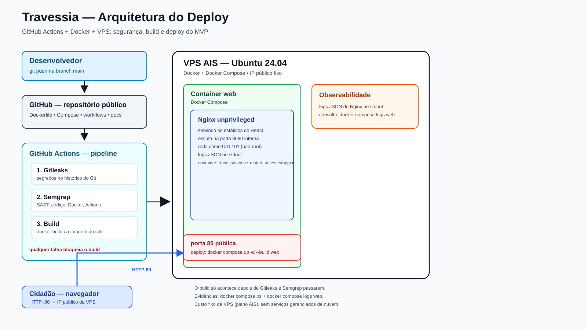

# Deploy em VPS — Travessia

**FIAP — Global Solution 2026.2 • CitizenTech**
**Secure DevOps Tools & Cloud Computing — Prof. Cleórbete Santos**

> **Antes de exportar o PDF:** confira o nome da equipe, os integrantes/RMs e salve os
> prints em `docs/prints/` com os nomes da seção 9. O arquivo `docs/relatorio.html` já
> está formatado para impressão. Repositório público:
> <https://github.com/guicvsub/gs-dev-sec>.

---

## 1. Identificação

| Campo | Valor |
| --- | --- |
| **Equipe** | GS7 (Global Solution 7) |
| **Integrantes** | Guilherme Santiago da Silva (RM552321), Gustavo Govea Soares (RM553842), Pedro Henrique Mello Silva Alves (RM554223), Gabriel Borba (RM553187) |
| **Repositório público** | <https://github.com/guicvsub/gs-dev-sec> |
| **MVP no ar** | <http://4.168.236.152> |
| **Pipeline** | <https://github.com/guicvsub/gs-dev-sec/actions/workflows/deploy.yml> |
| **Data** | 18 de novembro de 2026 |

---

## 2. Resumo executivo

O **Travessia** é o MVP da CitizenTech para apoiar pessoas cegas ou com baixa visão na
travessia de ruas. Uma câmera vestível filma a via; um modelo de visão computacional
reconhece faixa de pedestre, semáforo e veículos; o resultado é convertido em um aviso
simples em tela, voz e vibração.

Para o deploy seguro, o MVP foi empacotado em uma imagem Docker e publicado em uma **VPS
própria** (AIS, Ubuntu 24.04):

- **Segurança:** Gitleaks (segredos) e Semgrep (SAST) bloqueiam o pipeline.
- **Container:** o build do Vite gera os estáticos do site e o Nginx (não-root) os serve.
- **Deploy:** Docker Compose na VPS publica o container na porta 80.
- **Observabilidade:** logs JSON do Nginx no stdout do container.

O site público é a parte demonstrável do MVP: ele reproduz um vídeo de São Paulo com as
detecções precomputadas, sem depender de chave do Roboflow. O núcleo Python que chama o
Roboflow é opcional e não é iniciado pelo pipeline.

---

## 3. O problema e a solução

### Problema

A travessia de ruas é uma das tarefas mais arriscadas para pessoas com deficiência
visual. Semáforos, faixas e veículos mudam de estado rapidamente, e a bengala ou o cão-guia
não informam a cor do semáforo. A informação existe no ambiente, mas não chega de forma
acessível.

### Solução proposta

Uma câmera ESP32-CAM vestível captura a cena à frente. O núcleo em Python envia frames
ao modelo do Roboflow (classes `pedestrian_crossing`, `green_light`, `red_light` e
`vehicle`), aplica regras de decisão e gera uma mensagem curta, por exemplo:

- "Faixa de pedestre e semáforo verde a frente"
- "Faixa de pedestre e semáforo vermelho a frente"
- "Semáforo vermelho a frente (sem faixa de pedestre)"

No MVP, a câmera é substituída por um vídeo público do YouTube. O site em React mostra o
vídeo com as caixas de detecção e o aviso acessível. A troca do vídeo pela câmera exige
mudar apenas a fonte da imagem; a análise e as regras permanecem.

### Escopo deste repositório

| Parte | O que é | Entra no deploy? |
| --- | --- | --- |
| `frontend/` | Site React + Vite + Tailwind, com detecções salvas | **Sim** (MVP público) |
| `main.py` + `utility/` | Núcleo Python + OpenCV + Roboflow | Não (opcional, headless) |
| `Dockerfile` | Build do site + Nginx unprivileged | Sim |
| `Dockerfile.core` | Imagem do núcleo Python | Opcional, local |

---

## 4. Arquitetura



### Componentes

| Camada | Serviço | Configuração |
| --- | --- | --- |
| Aplicação | Container Docker `web` | Site em React servido pelo Nginx na 8080 |
| Servidor | VPS AIS (Ubuntu 24.04) | Docker + Docker Compose; IP público fixo |
| Proxy/Web | Nginx unprivileged | Porta 80 externa → 8080 interna |
| CI/CD | GitHub Actions | Gitleaks, Semgrep e build da imagem |
| Observabilidade | Logs JSON no stdout | Consulta com `docker compose logs web` |

### Decisões de arquitetura

1. **Site estático em Nginx:** o MVP não tem back-end; o build do Vite gera arquivos
   estáticos e o Nginx os serve. Isso reduz a superfície de ataque.
2. **Nginx unprivileged:** o container roda como UID 101 (nginx), não root.
3. **VPS dedicada:** custo fixo e simples, sem gerenciamento de nuvem; o IP público é
   estável.
4. **Docker Compose:** versões e serviços declarados em arquivo; fácil de reproduzir e
   atualizar.

---

## 5. Pipeline DevSecOps

O workflow principal é o [`deploy.yml`](../.github/workflows/deploy.yml). Ele roda em
todo push na `main` e por `workflow_dispatch`.

```text
push na main
  │
  ├─ security ─┬─ Gitleaks (histórico completo, --redact, exit code 1)
  │            └─ Semgrep  (p/default + p/secrets, SARIF como artefato)
  │
  └─ build ──── docker build da imagem do site
```

| Etapa | Ferramenta | O que faz | Critério de bloqueio |
| --- | --- | --- | --- |
| 1 | Gitleaks 8.28 | Procura segredos no histórico do Git | Qualquer finding |
| 2 | Semgrep | SAST em Python, JS, Dockerfile e workflows | Finding bloqueante |
| 3 | Docker | Build da imagem do site | Falha de build |

**Controles de segurança do pipeline:**

- O job `build` tem `needs: security`; se Gitleaks ou Semgrep falharem, ele não roda.
- As actions são fixadas pelo **SHA completo** do commit (não por tags móveis).
- O Gitleaks usa `--redact` para não imprimir o segredo no log.
- O Semgrep publica o SARIF como artefato para auditoria.

### Pipeline de pull request

O [`pr.yml`](../.github/workflows/pr.yml) roda em PRs para a `main`: segurança e build da
imagem. Isso impede que uma mudança quebre o build antes do merge.

### Deploy na VPS

O pipeline valida e constrói a imagem. A publicação na VPS é feita com Docker Compose
(veja o [`DEPLOY.md`](../DEPLOY.md)); o script `scripts/deploy-vps.sh` faz o
`git pull` + `docker compose up -d --build web`.

---

## 6. Segurança

### 6.1 Gestão de segredos

- A chave real do Roboflow fica apenas no `.env` local, que está no `.gitignore` e no
  `.dockerignore`.
- O `.env.example` contém somente o placeholder `sua_chave_do_roboflow_aqui`, permitido
  explicitamente no `.gitleaks.toml`.
- Se um segredo entrar no histórico, o Gitleaks falha. O procedimento é rotacionar a
  chave e limpar o histórico, nunca desativar o gate.

### 6.2 Infraestrutura

| Controle | Implementação |
| --- | --- |
| Superfície de rede | Container expõe só a porta 80; acesso via Docker |
| Servidor | VPS dedicada com `.env` fora do repositório |
| Container | Nginx unprivileged (UID 101) |
| Registry/entrega | Imagem construída na VPS com `--build` |
| CI/CD | Actions fixadas por SHA; Gitleaks + Semgrep como gate |

### 6.3 Limitações de segurança da atividade

- O site é HTTP, sem domínio, WAF ou HTTPS. A evolução é um proxy TLS (Caddy com Let's
  Encrypt, por exemplo).
- O deploy na VPS é manual (Docker Compose). Uma evolução é automatizar com SSH na
  pipeline.

---

## 7. Observabilidade

### 7.1 Logs

O Nginx grava access logs em JSON no stdout:

```json
{"time":"2026-11-18T20:59:20+00:00","remote_addr":"172.21.0.1","request":"GET / HTTP/1.1","status":200,"bytes":1002,"referer":"","user_agent":"curl/8.22.0"}
```

Consulte com:

```bash
docker compose logs web
```

O formato JSON permite filtrar por `status`, `request`, `remote_addr` e `user_agent`.

---

## 8. Custos

O custo desta solução é o **valor fixo da VPS** (sem os custos de serviços gerenciados de
nuvem). Para o MVP, uma VPS pequena é suficiente; o preço varia conforme o provedor
(nosso caso, a AIS).

Para o núcleo Python opcional, o custo é apenas o consumo de créditos do Roboflow.

---

## 9. Evidências

Salve os prints em `docs/prints/` com os nomes abaixo. O checklist detalhado está em
[`EVIDENCIAS.md`](EVIDENCIAS.md).

| # | Arquivo | O que deve mostrar |
| --- | --- | --- |
| 1 | `01-pipeline.png` | Run do workflow `Deploy` com os jobs `security` e `build` verdes. |
| 2 | `02-gitleaks.png` | Step do Gitleaks sem findings (ou o log do gate). |
| 3 | `03-semgrep.png` | Step do Semgrep com `0 findings` / artefato SARIF. |
| 4 | `04-build.png` | Step do build da imagem com sucesso. |
| 5 | `05-site.png` | Site público no navegador, com a URL visível. |
| 6 | `06-logs.png` | Saída de `docker compose logs web` com o JSON. |
| 7 | `07-vps.png` | Container `web` em execução na VPS (`docker compose ps`). |
| 8 | `08-repo.png` | Repositório público no GitHub. |

---

## 10. Como reproduzir

1. Crie o repositório público e envie o código (sem o `.env`).
2. Na VPS, instale Docker e Docker Compose.
3. Clone o projeto na VPS e suba com `docker compose up -d --build web`.
4. Confirme com `curl -I http://IP_DA_VPS`.

O passo a passo completo está em [`../DEPLOY.md`](../DEPLOY.md).

---

## 11. Limitações e próximos passos

| Limitação | Evolução sugerida |
| --- | --- |
| HTTP sem domínio/HTTPS | Caddy com Let's Encrypt, ou Cloudflare |
| Deploy manual na VPS | Integrar deploy à pipeline com SSH |
| Sem snapshot/backup | Snapshot periódico da VPS |
| Uma única instância | Replicar o container em múltiplas VPS atrás de um proxy |

---

## 12. Conclusão

O MVP atende aos entregáveis:

- **Repositório público** com `Dockerfile`, workflows e `docker-compose.yml`.
- **URL pública** do MVP na VPS.
- **Pipeline DevSecOps**: build, Gitleaks e Semgrep.
- **Observabilidade** com logs JSON consultáveis.
- **Ficha Técnica** no `README.md` e **relatório com arquitetura e evidências** neste
  documento/PDF.

O resultado é um MVP no ar de forma simples e reproduzível, com segurança reforçada na
pipeline e custo previsível de uma VPS dedicada.

---

## Referências

- [Repositório do projeto](https://github.com/guicvsub/gs-dev-sec)
- [Guia de deploy](../DEPLOY.md)
- [Checklist de evidências](EVIDENCIAS.md)
- [GitHub Actions — reusable workflows](https://docs.github.com/actions/using-workflows/reusing-workflows)